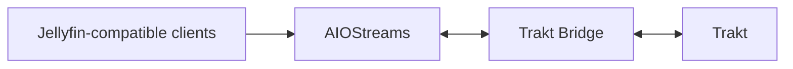
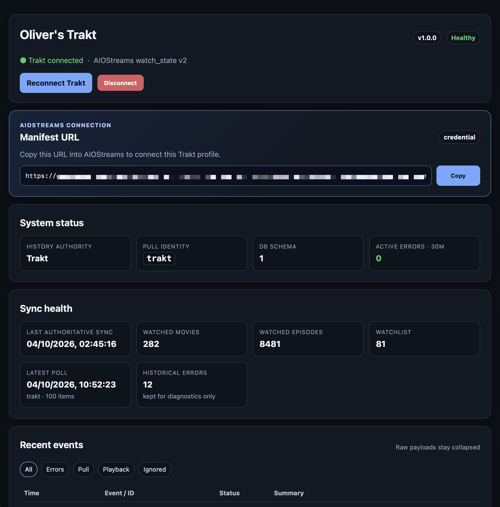

# HomeDocker Trakt Bridge

[](https://github.com/olivergiangvu/homedocker-trakt-bridge/actions/workflows/ci.yml)
[](https://github.com/olivergiangvu/homedocker-trakt-bridge/releases/latest)
[](LICENSE)

Self-hosted **Trakt sync for AIOStreams and Jellyfin-compatible clients**.

It keeps Trakt as the canonical watched/resume history while AIOStreams provides the Jellyfin-compatible playback/state surface used by clients such as Strand, Remux and Trellis.



## Dashboard



The operator dashboard exposes connection health, pull identity, authoritative watched/watchlist state and recent sync activity. The screenshot above is sanitized; live Manifest URLs are credentials and must not be published.

## Features

- playback scrobbling: start, pause and stop
- watched / unwatched history sync
- resume state pulled from Trakt into AIOStreams
- movie and show watchlist sync
- bulk season/show watched updates
- retry-safe and restart-safe processing
- Trakt rate-limit protection and bounded stale fallback
- native Trakt + AIOStreams coexistence
- optional read-only AIO local-state gap detection with per-item settlement, restart-safe coalescing and position-aware delivery correlation
- lightweight operator dashboard with health and sync status

## Quick start

Requirements: Docker Engine, Docker Compose, a Trakt API application and an HTTPS reverse proxy.

```bash
git clone https://github.com/olivergiangvu/homedocker-trakt-bridge.git
cd homedocker-trakt-bridge

cp .env.example .env
cp compose.example.yml compose.yml
```

Edit `.env` and set at least:

```env
PUBLIC_BASE_URL=https://trakt.example.com
TRAKT_CLIENT_ID=...
TRAKT_CLIENT_SECRET=...
BRIDGE_SECRET_KEY=...
ADMIN_KEY=...
```

Then start the bridge:

```bash
docker compose pull
docker compose up -d
```

The GHCR image is public, so anonymous pulls work without `docker login`.

For a long-lived production install, pin `TRAKT_BRIDGE_IMAGE` to a release tag or immutable digest instead of following `latest`.

Verify:

```bash
curl -fsS http://127.0.0.1:7000/health
curl -fsS http://127.0.0.1:7000/readiness
```

## Connect Trakt and AIOStreams

1. Open `https://your-domain/setup?key=<ADMIN_KEY>`.
2. Create a profile and connect Trakt through OAuth.
3. Copy the **Manifest URL** shown on the profile dashboard.
4. Add that manifest URL to AIOStreams.

Treat the manifest URL as a credential.

For clients that also use native Trakt directly, the recommended setting is:

```env
PULL_IDENTITY_MODE=trakt
```

If AIOMetadata is also part of the stack, use **Trackers = This server only** for the Jellyfin user so Trakt remains the single external watched/resume read authority.

## Documentation

- **[Getting started](docs/SETUP.md)** — install, connect Trakt and add the manifest to AIOStreams
- **[Configuration](docs/CONFIGURATION.md)** — image pinning, identity mode, freshness and reverse proxy settings
- **[Operations](docs/OPERATIONS.md)** — health, backup, update, rollback and logs
- **[HomeDocker stable upgrade](docs/STABLE-DEPLOYMENT.md)** — verified v1.3.0 release, RC6 preflight, Bridge-only deployment, protected Compose backup and rollback
- **[Integrations](docs/INTEGRATIONS.md)** — AIOMetadata and native-Trakt coexistence
- **[Troubleshooting](docs/TROUBLESHOOTING.md)** — common sync and identity problems
- **[Documentation index](docs/README.md)** — advanced and maintainer documentation
- **[RC7 phase closure / cleanup](docs/RC7-CLOSURE-AND-CLEANUP.md)** — archived experimental PRs, GitHub branch cleanup and Docker inventory policy

## Contributing

Bug reports, feature requests and pull requests are welcome. See **[CONTRIBUTING.md](CONTRIBUTING.md)** before opening a change, and never include live credentials or manifest URLs in public issues.

## Security

- Keep `ADMIN_KEY`, `BRIDGE_SECRET_KEY`, Trakt OAuth material and profile manifest URLs private.
- Do not expose container port `7000` directly to the Internet.
- Terminate HTTPS at a reverse proxy and forward only to `127.0.0.1:7000`.
- Back up `.env` and `/app/data/bridge.db` together.

For sensitive vulnerabilities, follow **[SECURITY.md](SECURITY.md)** instead of opening a public issue.

## Project status

**Latest published stable release:** [`v1.3.0`](https://github.com/olivergiangvu/homedocker-trakt-bridge/releases/tag/v1.3.0), published 2026-10-14 from immutable tag commit `8c505089e0c5ad2e7ce1514bd9c1acf1722bea95`. This promotes production-proven RC6 with **no application behavior or database-schema changes** after RC6. Release published is not proof of installation on any HomeDocker host.

**Last independently attested HomeDocker runtime (2026-10-13):** Bridge `v1.3.0-rc.6` pinned by digest. `main` contains the separately reviewed post-tag **operator-only deployment helper fix** (`ef336f4b730ec14bf995fa83cf170f034dc382a1`), which supports root-protected Compose `.env` and checks the existing RC7 dual-IMDb mitigation before/after a Bridge-only cutover. The published `v1.3.0` application image is not rebuilt by that fix.

**HomeDocker stable upgrade:** use the guarded [v1.3 deployment runbook](docs/STABLE-DEPLOYMENT.md) and host preflight. The runbook requires RC6 baseline, exact image provenance, SQLite online backup, Compose rollback and post-deploy health/identity acceptance. Until actual host output confirms success, do **not** state that HomeDocker is running v1.3 stable.

**AIOStreams:** independent upstream `ghcr.io/viren070/aiostreams:latest` (no forced pin or update during a Bridge-only deployment). `AIO_RECONCILER_MODE=compare` on the qualified HomeDocker is non-writing; recovery writeback remains excluded (Issue #70). Canonical Trakt identity and existing RC6 settings are preserved.

**v1.4 R23D research:** remains a **Draft/unsafe-for-production gateway-only branch** ([PR #95](https://github.com/olivergiangvu/homedocker-trakt-bridge/pull/95)). The isolated GitHub runner nft/guardian lease experiments do not establish HomeDocker boot-time fencing or an independent live watchdog. No v1.4 stable tag, image rollout, or authenticated gateway relay is authorized.

See [v1.3 release notes](docs/releases/v1.3.0.md), [release qualification](docs/design/v1.3-stable-qualification.md) and [documentation index](docs/README.md).

The v1.2 line keeps native-Trakt coexistence safeguards, direct provider-ID playback transport, family-scoped rate-limit recovery, semantic history dedupe, and the optional read-only AIO local-state reconciler. The reconciler remains **disabled by default**; when enabled in `detect` mode it never writes Trakt or AIOStreams, persists pending candidates across restart, coalesces newer same-item local rows, waits for the configured quiet window, and correlates final state only with an equivalent delivered HomeDocker playback position.

DB schema remains `1`; no database migration or pull-cache purge is required from v1.1.

License: [MIT](LICENSE).
