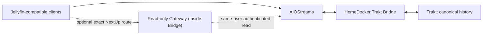

# HomeDocker Trakt Bridge

[](https://github.com/olivergiangvu/homedocker-trakt-bridge/actions/workflows/ci.yml)
[](https://github.com/olivergiangvu/homedocker-trakt-bridge/releases/latest)
[](LICENSE)

**Self-hosted Trakt watch-state and playback bridge for AIOStreams / Jellyfin-compatible clients**, with an optional read-only NextUp Identity Gateway in v1.4.0.

**Current published stable:** [v1.4.0](https://github.com/olivergiangvu/homedocker-trakt-bridge/releases/tag/v1.4.0), published 2026-10-20 from [commit `33e97c9`](https://github.com/olivergiangvu/homedocker-trakt-bridge/commit/33e97c9ffc52003f7f9ac11f37b7c092ef993207). Publication, a GHCR image, an installed host image, an enabled Gateway listener, and actual client routing are **different milestones**.

## What it does

- **Trakt remains the canonical watched/resume authority.** The Bridge synchronizes playback, watched/unwatched history, resume state and movie/show watchlists with AIOStreams `watch_state` v2.
- Supports start/pause/stop scrobbling, season/show watched updates, retry-safe/restart-safe processing, bounded Trakt rate-limit recovery and native-Trakt coexistence.
- Preserves an optional, non-writing AIO state comparison mode; no automatic history repair or recovery writeback.
- **v1.4 Unified Gateway:** in the *same Bridge process*, a separately provisioned Jellyfin-compatible read-only Gateway can filter verified **TV-series identity alias collisions** in eligible `GET /Shows/NextUp` responses.
- The Gateway's Identity Filter is **AUTO ON only for a valid, provisioned source/user/profile mapping**, with an immediate persistent per-source manual **OFF** override in the authenticated dashboard.



**Important Gateway boundary:** No second Trakt writer, second Bridge database or automatic client/nginx reconfiguration. The Gateway listener defaults to **OFF**. Unsupported NextUp request shapes, full/paginated pages, unknown counts and ambiguous identities pass through unchanged. Movies, Resume, playback and watch-history writes are not modified. A listening Gateway is **not** proof a client is routed through it.

## Dashboard


The screenshot is an older, sanitized example. The current unified dashboard exposes Bridge status and, when configured, Gateway listener/filter controls and anonymous metrics. Never publish actual profile Manifest URLs, Trakt OAuth tokens or administrator credentials.

## Quick start

Requirements: Docker Engine with Compose, a Trakt API application, and an HTTPS reverse proxy.

```bash
git clone https://github.com/olivergiangvu/homedocker-trakt-bridge.git
cd homedocker-trakt-bridge
cp .env.example .env
cp compose.example.yml compose.yml
```

Set at least these variables in the **private** `.env`:

```env
PUBLIC_BASE_URL=https://trakt.example.com
TRAKT_CLIENT_ID=...
TRAKT_CLIENT_SECRET=...
BRIDGE_SECRET_KEY=...
ADMIN_KEY=...
PULL_IDENTITY_MODE=trakt
```

For a first-time standalone example deployment:

```bash
docker compose pull
docker compose up -d
curl -fsS http://127.0.0.1:7000/health
curl -fsS http://127.0.0.1:7000/readiness
```

The example `.env.example` uses a mutable `:latest` reference, which may **not** reflect v1.4.0 Stable. Set the published v1.4 digest explicitly for a reproducible production install; a long-lived instance should never assume `:latest` is the newest reviewed release. **Do not use the generic full-stack Compose commands above for an existing HomeDocker production upgrade.** Use the [v1.4 operations guide](docs/STABLE-V1.4-OPERATIONS.md) and preserve service ownership, backups, AIOStreams and Gateway Compose configuration.

## Connect Trakt and AIOStreams

1. Open `https://your-domain/setup?key=<ADMIN_KEY>` over HTTPS.
2. Create a profile and authorize Trakt via OAuth.
3. Copy its **Manifest URL** from the dashboard and add it to AIOStreams.
4. Verify watched/resume state in a normal Jellyfin-compatible client.

The Manifest URL is a credential. For clients also using native Trakt, use `PULL_IDENTITY_MODE=trakt`. Where AIOMetadata participates, **Trackers = This server only** prevents secondary tracker readback from competing with the canonical Trakt state; separately enabled tracker *writes* are a different concern.

## Documentation

| Start here | Purpose |
| --- | --- |
| [Documentation index](docs/README.md) | Current guides versus historical release/research records |
| [Setup](docs/SETUP.md) | Fresh installs and connecting AIOStreams |
| [Configuration](docs/CONFIGURATION.md) | Image pinning, canonical identity, safe Gateway flags |
| [v1.4 stable operations](docs/STABLE-V1.4-OPERATIONS.md) | Production verification, safeguarded RC2→Stable runbook, rollback and cleanup policy |
| [Operations](docs/OPERATIONS.md) | Health, backups, diagnostics and upstream update boundaries |
| [Integrations](docs/INTEGRATIONS.md) | AIOStreams, AIOMetadata, native Trakt and client behavior |
| [Troubleshooting](docs/TROUBLESHOOTING.md) | Auth, rate limits, duplicate history and Gateway eligibility |
| [v1.4 release notes](docs/releases/v1.4.0.md) | Stable features, hard limits and release provenance |

Older [v1.3 deployment instructions](docs/STABLE-DEPLOYMENT.md), qualification reports, draft research and RC closure records are **retained for audit/rollback**, not current deployment instructions.

## Security and contribution

- Terminate public HTTPS at a reverse proxy; do not publish internal Bridge port `7000` or Gateway port `7101` directly.
- Keep `.env`, `BRIDGE_SECRET_KEY`, `ADMIN_KEY`, the SQLite database, OAuth material and Manifest URLs private.
- Only one live Bridge/Trakt writer should own its data volume and profile credentials.
- See [Security](SECURITY.md) and [Contributing](CONTRIBUTING.md) before reporting issues or contributing.

License: [MIT](LICENSE).
