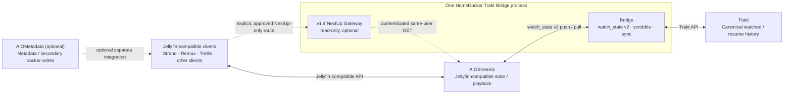

# HomeDocker Trakt Bridge

**One canonical Trakt history. One AIOStreams state bridge. One optional, read-only Jellyfin NextUp Gateway.**

[](https://github.com/olivergiangvu/homedocker-trakt-bridge/actions/workflows/ci.yml)
[](https://github.com/olivergiangvu/homedocker-trakt-bridge/releases/latest)
[](LICENSE)
[](https://github.com/olivergiangvu/homedocker-trakt-bridge/pkgs/container/homedocker-trakt-bridge)

A self-hosted **Trakt ↔ AIOStreams `watch_state` v2 bridge** for Jellyfin-compatible playback clients. It keeps **Trakt as the canonical watched/resume history** and makes that state available through AIOStreams, without turning secondary tracker histories into competing authorities.

**Current published stable: [v1.4.0 — Unified Gateway](https://github.com/olivergiangvu/homedocker-trakt-bridge/releases/tag/v1.4.0)** · Published **20 October 2026** · [Release notes](docs/releases/v1.4.0.md) · [What's changed](CHANGELOG.md)

> **Release ≠ deployment.** A published GitHub tag, a GHCR image, an installed HomeDocker container, an enabled Gateway listener and a client actually routing through that Gateway are independent states. This README describes released capabilities, **not** unverified behavior on every installation.

[**Quick start**](#quick-start--new-installation) · [**v1.4 Gateway**](#v14-unified-gateway) · [**How it works**](#architecture) · [**Production operations**](docs/STABLE-V1.4-OPERATIONS.md) · [**Full documentation**](docs/README.md)

---

## Why HomeDocker Trakt Bridge?

Different Jellyfin-compatible clients can expose playback, Continue Watching and watched-state through AIOStreams, while some of those same clients also integrate with Trakt natively. Without a clear source of truth, identity mismatches and overlapping write paths can create inconsistent watched/resume views or repeated history events.

HomeDocker Trakt Bridge offers a **single, auditable integration boundary**:

- **Read:** Trakt watched history, progress and watchlists → Bridge → AIOStreams / clients.
- **Write:** AIOStreams playback and watched/watchlist events → Bridge → Trakt, with retries, deduplication and rate-limit safeguards.
- **Observe:** health, connection state, errors and optional read-only AIO/Trakt comparisons.
- **Project, optionally in v1.4:** verified TV-series identity aliases into eligible **NextUp-only** responses, without modifying underlying watch history.

It is **not** a general Jellyfin server, a Trakt replacement, a bulk history-repair utility or a universal duplicate-card fix.

## Architecture



| Component | Responsibility |
| --- | --- |
| **Trakt** | Authoritative long-term watched history and resume progress |
| **Trakt Bridge** | One Trakt OAuth writer, state translation, scrobbling, reconciliation observations and operator dashboard |
| **AIOStreams** | Jellyfin-compatible playback and watched/resume state surface used by clients |
| **v1.4 NextUp Gateway** | Optional, same-process **read-only** projection for narrowly qualified TV-series identity collisions |
| **AIOMetadata (optional)** | Metadata/catalog and possible secondary-tracker write fan-out; **not** a competing external watched-history read authority |

**Design rule:** avoid multiple external tracker-history sources pushing conflicting watched/resume state back into the same AIOStreams/Jellyfin surface. Clients with native Trakt should converge on Trakt's identity namespace (see [Integrations](docs/INTEGRATIONS.md)).

## Features

| Capability | v1.4 status | Notes |
| --- | --- | --- |
| Trakt ↔ AIOStreams `watch_state` v2 | **Core** | Profile-specific push/pull integration |
| Start, pause and stop scrobbling | **Core** | Retry-safe processing and terminal-state guards |
| Watched/unwatched movies and episodes | **Core** | Includes supported season/show bulk watched changes |
| Resume/progress and movie/show watchlists | **Core** | Trakt remains authoritative |
| Native Trakt + AIOStreams coexistence | **Supported** | `PULL_IDENTITY_MODE=trakt` recommended |
| Semantic history dedupe and Trakt `429` handling | **Core** | Bounded cooldown, retries and stale-state safeguards |
| Dashboard / health / readiness | **Core** | Current state, operational events and error diagnosis |
| AIO local-state reconciler | **Optional, non-writing** | `detect` or `compare`; no automatic repair writeback |
| Unified NextUp Identity Gateway | **Optional in v1.4** | Requires operator provisioning and qualified client routing |
| All-client NextUp / Resume / movie deduplication | **Not supported** | Unsupported or ambiguous cases pass through unchanged |

## v1.4 Unified Gateway

v1.4 adds a **read-only Jellyfin NextUp Identity Gateway inside the existing Bridge process**. Where the upstream identity graph supports it, the Gateway can present a verified duplicate **TV-series alias collision** as one card in an eligible `GET /Shows/NextUp` response.

The default release does **not** launch a second Bridge, another SQLite database or another Trakt writer. It also does **not** automatically route any client to the Gateway.

### Three separate activation stages

| Stage | What it means | Automatic? |
| --- | --- | --- |
| **1. Provision listener** | Operator enables the Gateway and supplies an exact upstream source, Jellyfin user and Bridge profile mapping | **No** — example default is OFF |
| **2. Enable effective filter** | For a valid provisioned mapping, Identity Filter is **AUTO ON**; authenticated **manual OFF** takes precedence and persists across restarts | **Yes, only after valid provisioning** |
| **3. Route a client** | An operator separately verifies an approved, **NextUp-only** client request path through the Gateway | **No** — never implied by a listening socket |

**Scope limitations (intentional):**

- Only verified **TV-series** aliases in supported, coherent, short first-page NextUp responses.
- Full/paginated results, unsupported query shapes, unknown/inconsistent counts and ambiguous identity or Resume conditions are **passed through unchanged**.
- **Movies, `/UserItems/Resume`, normal playback, watched markers and Trakt history are not rewritten.**
- Not a universal fix for Odin, AIOStreams Desktop or other clients. Large-shelf/off-window item insertion remains research, **not** a v1.4 release feature.
- **Port `7101` is an internal listener only.** Never expose it publicly or repoint an entire Jellyfin client/API base URL at a NextUp-only Gateway.

For exact operating boundaries, see [v1.4 Stable operations](docs/STABLE-V1.4-OPERATIONS.md), [Configuration](docs/CONFIGURATION.md) and [release limitations](docs/releases/v1.4.0.md).

## Quick start — new installation

> These instructions are for a **new standalone installation**, not an upgrade of an existing HomeDocker/Portainer production stack. Production operators should use the [verified v1.4 guide](docs/STABLE-V1.4-OPERATIONS.md) instead.

**Prerequisites:** Linux/Docker Engine with Docker Compose, a Trakt API application, AIOStreams supporting `watch_state` v2 and an HTTPS reverse proxy (for example, host nginx).

**1. Prepare files**

```bash
git clone https://github.com/olivergiangvu/homedocker-trakt-bridge.git
cd homedocker-trakt-bridge
cp .env.example .env
cp compose.example.yml compose.yml
```

**2. Configure `.env` securely**

```env
# For a reproducible v1.4.0 install, select the reviewed immutable image:
TRAKT_BRIDGE_IMAGE=ghcr.io/olivergiangvu/homedocker-trakt-bridge@sha256:61c28bd22155950cacfd7ac47e5d5259a74e55c5b99c3dc4b63d95be524f2c77

PUBLIC_BASE_URL=https://trakt.example.com
TRAKT_CLIENT_ID=...
TRAKT_CLIENT_SECRET=...
BRIDGE_SECRET_KEY=...
ADMIN_KEY=...
PULL_IDENTITY_MODE=trakt

# Optional Gateway stays off until separately provisioned and tested.
JELLYFIN_GATEWAY_ENABLED=false
```

Generate private `BRIDGE_SECRET_KEY` and `ADMIN_KEY` values independently with `openssl rand -hex 32`. The `.env.example` file starts with a **mutable `:latest` example**, which is **not** a guarantee of the published v1.4 Stable image; replace that image reference before starting production.

**3. Start and verify**

```bash
docker compose pull
docker compose up -d

curl -fsS http://127.0.0.1:7000/health
curl -fsS http://127.0.0.1:7000/readiness
```

The sample Compose binds Bridge to **`127.0.0.1:7000`**, not a public interface. Terminate HTTPS at your host reverse proxy and ensure `PUBLIC_BASE_URL` matches the externally reachable HTTPS address. An unconfigured instance may answer process health before profile-level readiness is satisfied.

**4. Connect Trakt and AIOStreams**

1. Visit `https://your-domain/setup?key=<ADMIN_KEY>` over HTTPS and authorize your Trakt profile.
2. Open the authenticated dashboard and copy the profile-specific **Manifest URL**.
3. Add that Manifest URL to AIOStreams, then allow an initial authoritative sync.
4. Verify actual watched/resume behavior in a connected Jellyfin-compatible client.

**Treat both the setup URL and profile Manifest URL as credentials.** Do not publish them in issues, screenshots or logs.

[Detailed setup](docs/SETUP.md) · [Environment reference](docs/CONFIGURATION.md) · [Common problems](docs/TROUBLESHOOTING.md)

## Safe operation and updates

- **One writer:** never run two Bridge instances sharing `/app/data`, a SQLite database or Trakt OAuth credentials.
- **Back up together:** a consistent SQLite **online backup** of `/app/data/bridge.db`, private `.env`, Compose files (including `compose.gateway.yml` if present), and relevant reverse-proxy configuration. The `BRIDGE_SECRET_KEY` is necessary to decrypt stored OAuth tokens after restore.
- **Pin the Bridge:** use an immutable GHCR digest in long-lived production installs. AIOStreams is an **independent upstream** and may follow its own rolling `latest` policy; do not silently update or pin AIOStreams as part of a Bridge-only change.
- **Use scoped updates:** change **only** the Bridge service under its real Compose owner. Avoid generic whole-stack redeploys or `docker compose down -v`.
- **Verify separately:** Bridge `/health` and `/readiness`, actual container image ID, Trakt identity/watched/resume, Gateway effective state and **real authorized client routing** are distinct checks.
- **Keep rollback assets:** protect previous known-good image and corresponding SQLite/Compose snapshot. Do not prune unknown untagged images or volumes solely to reclaim a small amount of disk space.

For HomeDocker, the old RC2 → v1.4.0 guarded helper is a **one-time, RC2-specific cutover**, **not** a maintenance command to re-run on stable production. Read [v1.4 Stable operations](docs/STABLE-V1.4-OPERATIONS.md) before considering a rollout.

## Documentation

| Guide | Start here when… |
| --- | --- |
| [Documentation index](docs/README.md) | You need the current guide vs. historical archive map |
| [Setup](docs/SETUP.md) | Installing and connecting Trakt + AIOStreams |
| [Configuration](docs/CONFIGURATION.md) | Tuning identity, freshness, optional reconciler and Gateway |
| [v1.4 Stable operations](docs/STABLE-V1.4-OPERATIONS.md) | Checking HomeDocker runtime, safe upgrades and rollback |
| [Operations](docs/OPERATIONS.md) | Health, backups, logs, updates and recovery |
| [Architecture](docs/ARCHITECTURE.md) | Reviewing authority, trust boundaries and read/write paths |
| [Integrations](docs/INTEGRATIONS.md) | Connecting AIOStreams, AIOMetadata and native-Trakt clients |
| [Troubleshooting](docs/TROUBLESHOOTING.md) | Diagnosing duplicate history, NextUp, auth and rate limits |
| [Release notes](docs/releases/v1.4.0.md) / [Changelog](CHANGELOG.md) | What's shipped in v1.4 and earlier |

Historical v1.3 runbooks, RC qualification records and R23D security experiments are retained for **audit and rollback**. Their old version/HOLD checkpoints are not the current published release status; see the [documentation index](docs/README.md).

<details>
<summary>Historical dashboard preview (sanitized v1.0-era screenshot)</summary>


This archival image is **not** a depiction of the v1.4 unified Gateway dashboard. Do not publish live OAuth credentials, profile Manifest URLs or private endpoints in screenshots.

</details>

## Security, contributing and license

- **Do not expose** Bridge `7000` or internal NextUp Gateway `7101` directly to the Internet. Use a controlled HTTPS reverse proxy and least-privilege access.
- Keep `.env`, `ADMIN_KEY`, `BRIDGE_SECRET_KEY`, Trakt OAuth tokens, database backups and Manifest URLs private.
- Never treat an identity mismatch as permission to delete watched-state data or bulk replay Trakt history.
- Report security issues through [SECURITY.md](SECURITY.md); for bugs/features and PR guidelines, see [CONTRIBUTING.md](CONTRIBUTING.md).

**License:** [MIT](LICENSE).
