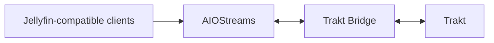

# Documentation

This is the versioned user manual for HomeDocker Trakt Bridge.

The repository and GHCR package are public. **v1.3.0 is published stable (2026-10-14)**, promoted from qualified RC6 with no behavior/schema changes. The latest confirmed HomeDocker runtime in the release records is still RC6; actual host upgrade must be verified separately. AIOStreams remains independently rolling on `latest`. **v1.4 R23D is research-only in Draft PR #95, not a stable release.**

## User guides

| Guide | Use it for |
| --- | --- |
| [Setup](SETUP.md) | Install the bridge, connect Trakt and add the manifest to AIOStreams |
| [Configuration](CONFIGURATION.md) | Image version, identity mode, freshness, reverse proxy and AIOMetadata settings |
| [Operations](OPERATIONS.md) | Health checks, backups, updates, rollback and logs |
| [Integrations](INTEGRATIONS.md) | Native Trakt, AIOStreams, AIOMetadata and Jellyfin-compatible clients |
| [Troubleshooting](TROUBLESHOOTING.md) | Common sync, OAuth, rate-limit, identity and duplicate-history diagnostics |

If you are installing the bridge for the first time, start with **[Setup](SETUP.md)**.

## How the system fits together



The recommended authority model is:

```text
Trakt        = canonical watched/resume history
Trakt Bridge = sync layer
AIOStreams   = Jellyfin-compatible playback/state surface
AIOMetadata  = metadata/catalog + optional secondary-tracker write fan-out
```

## Current release and upgrade

| Item | Canonical record |
| --- | --- |
| Latest published stable | [v1.3.0 release](https://github.com/olivergiangvu/homedocker-trakt-bridge/releases/tag/v1.3.0) — immutable tag and published image |
| Bridge-only HomeDocker upgrade | [Stable deployment runbook](STABLE-DEPLOYMENT.md) — exact source pin, guarded preflight, SQLite backup, rollback and acceptance |
| Stable qualification history | [v1.3 operator evidence and limitations](design/v1.3-stable-qualification.md) — evidence through 2026-10-13; later publication does not rewrite historic observations |
| Historical release notes | [Versioned archive](releases/) — preserve RC notes and stable records for audit |
| Unreleased v1.4 Unified Gateway | [Phase closure and release HOLD](V140-PHASE-CLOSURE-AND-RELEASE-HOLD.md) — qualified lab milestones, missing production fences, no v1.4 tag/deploy; [Draft PR #95](https://github.com/olivergiangvu/homedocker-trakt-bridge/pull/95) holds detailed prototype evidence |

**Documentation cleanup policy:** keep `docs/releases/v*.md`, RC7 closure reports and rollback references intact. Keep general user instructions in the main five guides, release deployment in this one runbook, and experimental v1.4 documentation on its separate Draft PR branch. No deletion of tagged history or production rollback artifacts.

## Advanced / maintainer docs

These pages are intentionally kept out of the main README because most users do not need them:

- [Architecture](ARCHITECTURE.md) — protocol boundaries and authority model
- [Development](DEVELOPMENT.md) — contributor notes, identity edge cases, tests and release engineering
- [Release acceptance records](releases/) — canary, published-artifact and HomeDocker acceptance history
- [RC7 closure and cleanup](RC7-CLOSURE-AND-CLEANUP.md) — operational acceptance, archived PRs, branch housekeeping and Docker safe inventory
- [v1.3 Stable qualification](design/v1.3-stable-qualification.md) — historical live RC6 evidence, residual risk and the accepted publication boundary
- [Security policy](../SECURITY.md)
- [Changelog](../CHANGELOG.md)

`/docs` is the canonical versioned documentation and changes together with the code. A GitHub Wiki can be added later for tutorials/FAQ if the public project grows, without moving release-specific or version-sensitive instructions out of the repository.
